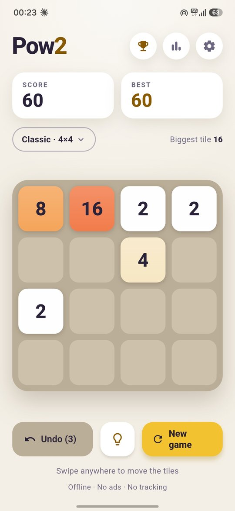
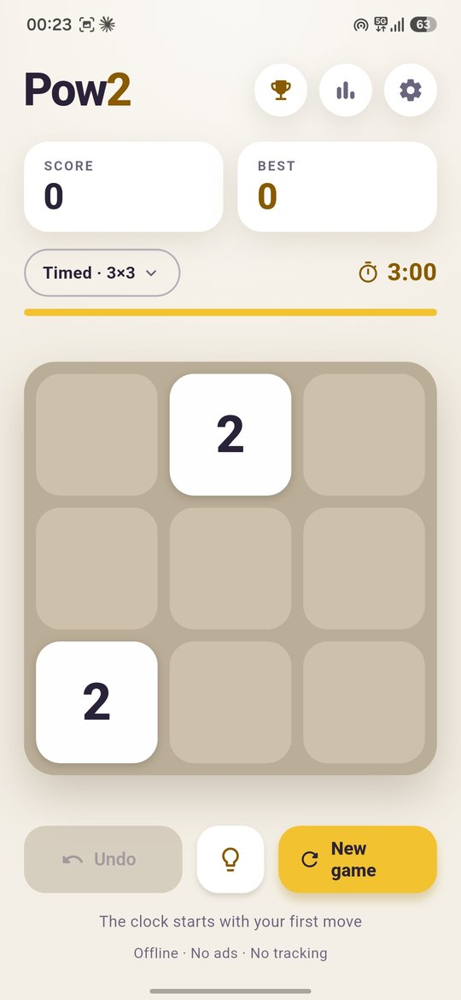
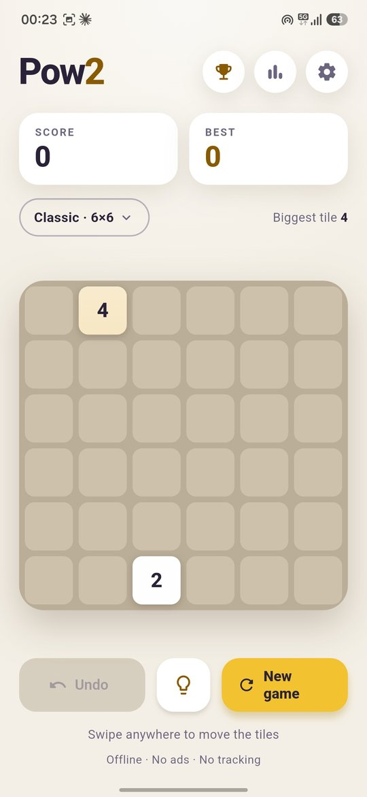
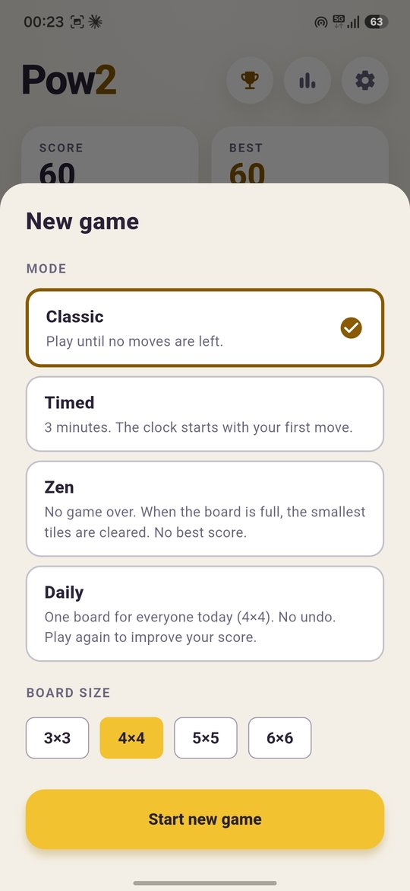
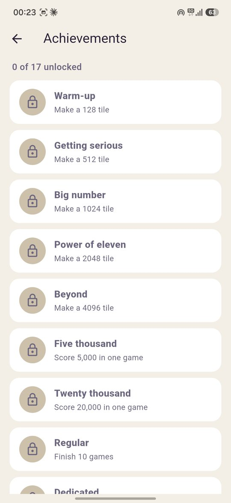
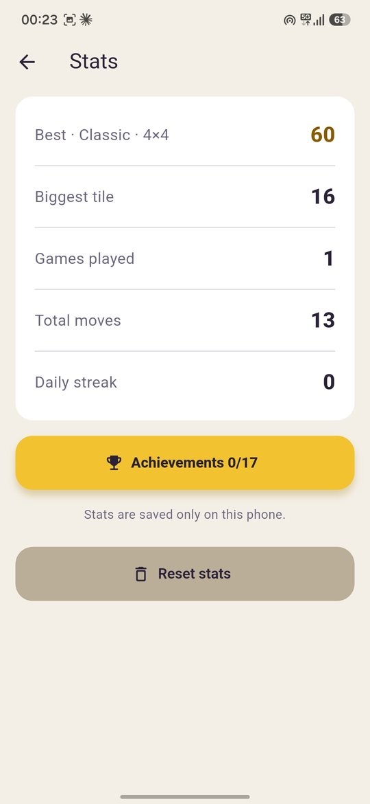
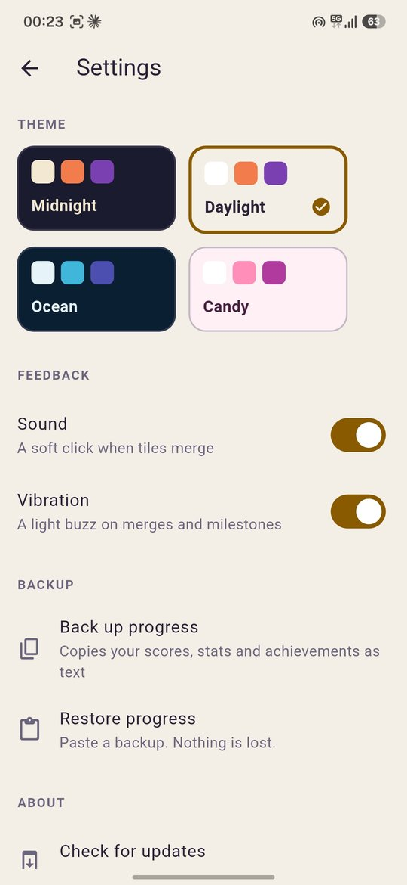

<div align="center">

# Pow2

**Swipe. Merge. Keep growing.**

A calm, fast number-merging puzzle for Android.
No ads. No tracking. No accounts. Works fully offline.


<br>


&nbsp;

&nbsp;


</div>

## What is Pow2?

Slide the tiles, merge equal numbers and make bigger ones: 2 + 2 = 4, 4 + 4 = 8, and so on. There is no fixed goal. The game is endless, so you play for your own best, and Pow2 cheers for you when you reach big tiles.

Pow2 is part of [Lumio Apps](https://github.com/lumio-apps): small, private, open source apps.

## Download

Get the latest APK from the [**Releases**](https://github.com/lumio-apps/pow2/releases/latest) page and open it on your phone. Allow "Install unknown apps" for your browser or file manager if Android asks.

Pow2 is distributed on GitHub only. It is not on the Play Store or F-Droid.

**Updates:** open **Settings → Check for updates**. Pow2 looks for a newer release on GitHub and installs it over the old one. Your scores, stats and achievements stay.

## Features

| | |
|---|---|
| **Modes** | **Classic**: play until no moves are left. **Timed**: 3 minutes, the clock starts with your first move. **Zen**: no game over, a full board clears its smallest tiles. **Daily**: one 4×4 board per day, the same for everyone, with a streak. |
| **Board sizes** | 3×3, 4×4, 5×5 and 6×6 |
| **Undo** | Take back up to 3 moves (not in the daily challenge) |
| **Hint** | A light bulb button shows a good next swipe |
| **Achievements** | 17 of them, from "Warm-up" to "Week streak" |
| **Stats** | Best score for every mode and size, biggest tile, games played, total moves, daily streak |
| **Themes** | Midnight, Daylight, Ocean and Candy |
| **Share** | Share your score as a picture when a game ends |
| **Backup** | Copy your progress as text and restore it on another phone |
| **Feel** | Smooth slides, merge pops, counting score, optional sound and vibration. Animations turn off when your phone's "Remove animations" is on. |

<div align="center">


&nbsp;

&nbsp;

&nbsp;


</div>

## How to play

- **Swipe anywhere** on the screen to slide all tiles in that direction.
- Two tiles with the **same number** merge into one with double the value.
- After every move a new **2** (sometimes a **4**) appears.
- The game ends when the board is full and nothing can merge.

Tap the mode chip (for example *Classic · 4×4*) to change the mode or the board size.

## Privacy

- No ads, no analytics, no accounts, no trackers.
- Scores, stats, achievements and your running game are stored **only on your phone**.
- The only network request is when you tap **Check for updates**: Pow2 asks the GitHub API for the newest release and, if you agree, downloads the APK from GitHub Releases. Nothing about you or your phone is sent.
- The share picture is drawn on your phone and handed to the Android share sheet. You choose where it goes.

## Build from source

You need the [Flutter SDK](https://docs.flutter.dev/get-started/install) and an Android device or emulator.

```sh
git clone https://github.com/lumio-apps/pow2.git
cd pow2
flutter pub get
flutter run
```

Run the checks:

```sh
flutter analyze
flutter test
```

### Project layout

```
lib/
  game/        Game rules (pure Dart): engine, modes, hint, daily, achievements, storage
  screens/     Game, Stats, Achievements and Settings screens
  widgets/     Board, tiles, buttons, setup sheet, game over card
  theme.dart   The four colour themes
  ...          App controller, updater, share picture
test/          Unit and widget tests
```

The game rules in `lib/game/` have no Flutter dependency, so they are easy to test and reuse.

## Releases

Pushing a version tag such as `v1.6.0` starts the **Release** workflow. It builds the APK, signs it with the key stored in the repository secrets and publishes it on GitHub Releases. Pushes to `main` run the **CI** workflow (`flutter analyze` and `flutter test`).

Required repository secrets: `KEYSTORE_BASE64`, `KEYSTORE_PASSWORD`, `KEY_ALIAS`, `KEY_PASSWORD`.

## Roadmap

See [ROADMAP.md](ROADMAP.md).

## Contributing

Bug reports and ideas are welcome in [Issues](https://github.com/lumio-apps/pow2/issues). Please keep in mind the rules of the project: offline first, no ads, no tracking.

## License

MIT, see [LICENSE](LICENSE).
